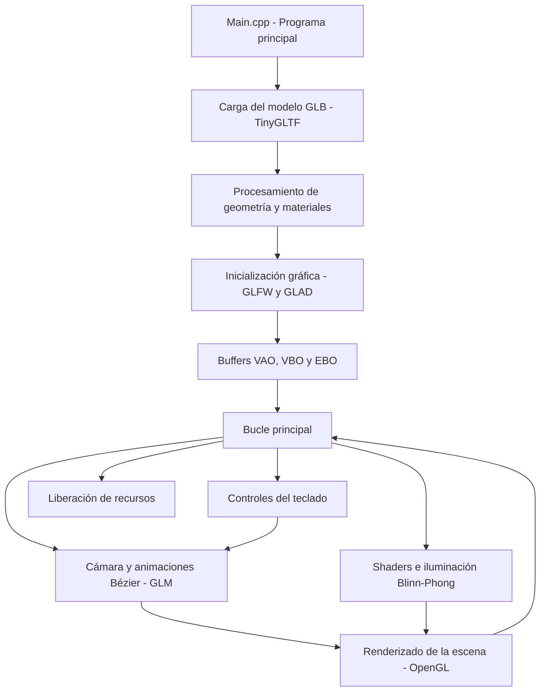

# OpenGL-3D-Matilda

**Estudiante:** Samara Stacey Castañeda Gómez  
**Código estudiantil:** 6014442  
**Universidad:** Universidad Militar Nueva Granada  
**Programa:** Ingeniería en Multimedia  
**Asignatura:** Computación Gráfica  
**Proyecto:** Visualización y animación de un modelo 3D con OpenGL  
**Año:** 2026

---

## Descripción del proyecto

Este proyecto consiste en la visualización y animación de un modelo tridimensional llamado **Matilda**, desarrollado en C++ mediante OpenGL.

Su propósito es aplicar conceptos de gráficos por computadora, como las transformaciones 3D, el manejo de cámaras, la iluminación y las animaciones mediante curvas Bézier, permitiendo interactuar con el modelo dentro de un entorno tridimensional.

## Herramientas y bibliotecas utilizadas

- **C++:** lenguaje de programación utilizado para desarrollar el proyecto.
- **OpenGL 3.3:** renderizado de los gráficos tridimensionales.
- **GLFW:** creación de la ventana y manejo de entradas del teclado.
- **GLAD:** carga de las funciones de OpenGL.
- **GLM:** operaciones matemáticas con vectores, matrices y transformaciones.
- **TinyGLTF:** carga y procesamiento del modelo 3D en formato `.glb`.
- **GLSL:** lenguaje utilizado para programar los shaders.
- **Visual Studio:** entorno de desarrollo utilizado.

## Funcionalidades principales

### Carga y visualización del modelo 3D

Se utiliza TinyGLTF para cargar el modelo Matilda desde el archivo `Models/Matilda.glb`. Se procesan sus vértices, índices, normales, materiales y texturas para representarlo mediante OpenGL.

### Transformaciones y cámara

Se emplean matrices de modelo, vista y proyección para posicionar y visualizar los elementos de la escena. La cámara puede controlarse manualmente mediante el teclado o seguir una trayectoria automática.

### Iluminación Blinn-Phong

Se implementa un modelo de iluminación con componentes ambientales, difusas y especulares, que permite apreciar mejor el volumen y las superficies del personaje. La iluminación puede activarse o desactivarse durante la ejecución.

### Animación mediante curvas Bézier

Se utilizan curvas Bézier cúbicas para generar trayectorias suaves. El programa permite mover el personaje, la cámara o ambos, además de visualizar la trayectoria del personaje y sus puntos de control.

### Interacción mediante el teclado

Se incorporan controles para desplazar la cámara, seleccionar modos de animación, pausar movimientos y activar o desactivar elementos de visualización.

## Arquitectura del software

El proyecto utiliza una arquitectura monolítica organizada por funciones, donde los componentes principales se integran en el archivo `Main.cpp`.

El programa coordina la carga del modelo, la configuración de OpenGL, el manejo de la cámara, las animaciones, la iluminación y el renderizado de la escena.

### Componentes principales

| Componente | Función |
|---|---|
| **Carga del modelo** | TinyGLTF lee el archivo `.glb` y obtiene la información del modelo tridimensional. |
| **Procesamiento de geometría** | Organiza vértices, índices, normales y materiales para su representación. |
| **Configuración gráfica** | GLFW y GLAD permiten crear la ventana e inicializar OpenGL. |
| **Buffers gráficos** | VAO, VBO y EBO almacenan y organizan los datos utilizados durante el renderizado. |
| **Shaders e iluminación** | Los shaders GLSL procesan la geometría, las texturas y la iluminación Blinn-Phong. |
| **Cámara y transformaciones** | GLM permite calcular las matrices de modelo, vista y proyección. |
| **Animaciones Bézier** | Calcula trayectorias para controlar el movimiento del personaje y la cámara. |
| **Interacción** | Procesa las entradas del teclado y actualiza las opciones de visualización. |

### Diagrama de arquitectura

### Flujo de ejecución

1. **Carga del modelo:** se lee el archivo GLB, se extrae su geometría y se calculan el centro y la escala del personaje.
2. **Inicialización gráfica:** se crea la ventana, se configura OpenGL y se preparan los shaders, buffers y texturas.
3. **Actualización:** en cada fotograma se procesan las entradas del teclado y se calculan las posiciones de la cámara y del personaje.
4. **Renderizado:** se aplican las transformaciones, texturas e iluminación para dibujar el modelo y, cuando están activadas, la curva Bézier y sus puntos de control.
5. **Finalización:** al cerrar la ventana, se liberan los recursos gráficos utilizados.

## Controles del programa

### Movimiento de cámara

| Tecla | Función |
|---|---|
| `W` / `S` | Avanzar y retroceder |
| `A` / `D` | Mover a izquierda y derecha |
| `Q` / `E` | Bajar y subir |
| `Flechas` | Girar la cámara |
| `Shift` | Aumentar la velocidad de movimiento |
| `R` | Reiniciar la cámara |

Los controles manuales de la cámara están disponibles en los modos `0` y `1`.

### Modos de animación

| Tecla | Función |
|---|---|
| `0` | Cámara manual y modelo quieto |
| `1` | Mover el personaje mediante Bézier, con cámara manual |
| `2` | Mover la cámara mediante Bézier, con personaje quieto |
| `3` | Mover el personaje y la cámara mediante Bézier |
| `Espacio` | Pausar o reanudar la trayectoria |

### Visualización y otros controles

| Tecla | Función |
|---|---|
| `B` | Mostrar u ocultar la curva Bézier |
| `P` | Mostrar u ocultar los puntos de control |
| `L` | Activar o desactivar la iluminación Blinn-Phong |
| `ESC` | Cerrar el programa |

## Estructura del proyecto

- `Main.cpp`: contiene la configuración de OpenGL, la carga del modelo, los shaders, la iluminación, las transformaciones, los controles y las animaciones.
- `Models/`: contiene el archivo `Matilda.glb` utilizado para representar el personaje.
- `Libraries/`: incluye las bibliotecas y dependencias utilizadas.
- **Archivos de Visual Studio:** permiten abrir, configurar y compilar el proyecto.

## Ejecución del proyecto

El proyecto fue desarrollado en **Visual Studio**, utilizando C++ y OpenGL 3.3.

Para ejecutarlo:

1. Descargar o clonar el repositorio.
2. Abrir la solución correspondiente en Visual Studio.
3. Verificar las rutas de las bibliotecas y del archivo `Models/Matilda.glb`.
4. Seleccionar la configuración **Debug | x64**, si está disponible.
5. Compilar y ejecutar el programa.

Al iniciar, se carga el modelo Matilda y se habilitan los controles del teclado para interactuar con la escena y sus animaciones.

**Nota:** Al ejecutar el proyecto en otro computador, puede ser necesario ajustar las rutas de las bibliotecas o del modelo 3D. El archivo GLB se carga mediante una ruta relativa al directorio de trabajo.

## Objetivo de aprendizaje

El desarrollo de este proyecto permitió aplicar conocimientos de gráficos por computadora mediante la integración de modelos tridimensionales, transformaciones, iluminación, manejo de cámaras y animaciones con curvas Bézier utilizando OpenGL.

